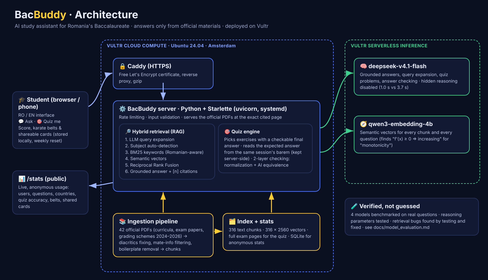

# 📚 BacBuddy

**An AI study assistant for Romania's Baccalaureate exam (Bacalaureat) that answers only from the official exam materials and shows you exactly where every answer comes from.**

🔗 **Live demo:** https://108-61-189-232.sslip.io
📊 **Live usage stats:** https://108-61-189-232.sslip.io/stats
🏁 Built solo for **HackGlobal 2026** (Polaris School of Technology × Vultr) · Track: *Grounded knowledge and RAG*



---

## Why I built this

I'm a 12th-grade student in the Math & Computer Science track at Colegiul Național Petru Rareș in Piatra Neamț, Romania, so I'm preparing for the Bac myself this year.

Every year more than 100,000 students in Romania take the Baccalaureate. Everything you need to prepare is technically public: the official curriculum (*programa*), past exam papers (*subiecte*) and the official grading schemes (*bareme*). The problem is that it's spread across dozens of PDFs, and when you ask a normal AI chatbot something like *"how is this exercise graded?"*, it often answers confidently and gets it wrong. It invents points or uses rules that aren't in the official barem, and you can't tell.

I wanted a tool I'd actually use myself: one that **only** answers from the official documents, **cites the exact page**, and says *"I couldn't find this"* instead of guessing.

## What it does

### 💬 Ask
- Ask anything about the Math (M_mate-info) or Computer Science (C/C++) Bac, in **Romanian or English**
- Every claim in the answer has a citation like **[1]**, and every source opens the **official PDF at the exact page**
- If the official materials don't cover the question, BacBuddy says so instead of making something up
- Math is rendered properly (LaTeX via KaTeX), and C/C++ code stays intact

### 🎯 Quiz me
- Gives you a real exercise from a past Bac paper, picking only exercises that have a checkable final answer
- You type your final answer and it's **checked against the official grading scheme** of the same exam session
- Checking is done in two layers so formatting doesn't matter: `x = 3`, `3`, `0,5` / `0.5` and `{3, 1}` / `{1,3}` are all accepted, and the AI only judges real equivalences like `1/2` = `0.5`
- The correct answer stays on the server, so you can't peek at it from the page source
- Problems don't repeat until you've seen all of them

### 🥋 Score, karate belts and shareable cards
- **+10** for a correct answer, **+5** if you used the hint, **−3** for a wrong one, plus a **🔥 streak bonus** every 3 in a row
- Weekly season: the score resets every Monday, so there's always a reason to come back
- Belts like in karate: white → yellow → **orange (100 points)** → green → blue → brown → **black**. The whole interface changes colour with your belt.
- Every new belt gives you confetti, a motivational message and an **achievement card** you can download or share (Instagram, WhatsApp…) with a link back to BacBuddy

### 📊 Live stats
A public `/stats` page with anonymous, real usage: unique users, questions, practice problems, countries, quiz accuracy, belts earned and cards shared.

## Reach: getting it to real users

Reach is part of the judging, so I didn't want BacBuddy to stay a project only I used:
- I shared it with **classmates in Romania**, who are exactly the people it's built for
- I sent it to **friends abroad (UAE and Sweden)** and asked them to try it and give feedback
- The **achievement cards** are designed for sharing, so every student who reaches a new belt can post their progress with the link
- The visitor's country is detected from the device's time zone, and visitors can change it. I deliberately did **not** fake any numbers: everything on `/stats` is real usage.

## How it works

1. **Ingestion** (`app/ingest.py`): 42 official PDFs (curricula + 20 Math and 20 CS exam papers and grading schemes, 2024–2026) are parsed and cleaned:
   - Romanian diacritics fixed (old cedilla `ş/ţ` → correct `ș/ț`, words split by the PDF extractor are joined back)
   - the curriculum PDFs contain every school profile, so pages for other profiles are filtered out (21 pages)
   - headers, footers and general rules repeated in every grading scheme are removed (1026 lines), so search finds the actual grading items
   - result: **316 searchable chunks**, plus full exam pages kept for the quiz
2. **Hybrid retrieval** (`app/rag.py`, `app/search.py`):
   - the AI first rewrites the question into the words used in official papers (*"monotonicity"* → *increasing, decreasing, sign of the derivative*)
   - the subject is detected automatically (*function, derivative* → Math; *algorithm, subprogram, C++* → CS)
   - **BM25** keyword search (Romanian-aware, works without diacritics) + **semantic search** with `qwen3-embedding-4b` vectors (316 × 2560), combined with **Reciprocal Rank Fusion**
   - grading questions are guaranteed to include grading-scheme passages
3. **Grounded answer**: `deepseek-v4.1-flash` answers only from the numbered sources, cites them, and states what the materials don't cover
4. **Quiz engine** (`app/quiz.py`): one AI call turns an exercise into a clean problem, gives a hint and reads the expected answer from the barem; answers are then checked as described above

## How I tested it (and what the tests caught)

I didn't want to just pick a model and hope. I went through the code file by file to understand how each part works, then tested every feature on real Bac questions. Everything is documented in [`docs/model_evaluation.md`](docs/model_evaluation.md).

- **Compared 4 models** on Vultr Serverless Inference with the same real question (`app/compare_models.py`): `glm-5.3` (37.6 s), `deepseek-v4.1-flash` (**3.8 s**), `qwen3.8-27b` (5.1 s), `mimo-v2.6-pro` (6.2 s). I picked DeepSeek Flash. Good sign: **none of the 4 invented grading points** when the sources didn't contain them.
- That test exposed two **retrieval bugs**: grading schemes never use the word "monotonicity", and a Math question was pulling CS grading schemes. Fixed with query expansion, subject detection and, later, hybrid semantic search.
- Quiz problems were sometimes **empty**. My debug script (`app/debug_quiz.py`) showed the model spent its whole token budget on hidden reasoning (`reasoning_tokens: 1500`, empty content). I tested 4 ways to limit it (`app/test_reasoning.py`) and only one worked: answers went from 3.7 s and empty to **1.0 s and correct**.
- Other bugs found by actually using the app and fixed:
  - quiz exercises cut in half → now built from full exam pages
  - C/C++ code like `m[4][25]` was rendered as citation badges → fixed
  - "write a program" tasks appearing in the quiz → filtered out
  - the same problem repeating (it appears in several exam sessions) → deduplicated, with no repeats until you've seen them all
  - answers with *"respectiv"* must keep the order of values → handled
- Deployment issues I solved along the way: a Vultr plan without a boot disk, a mistyped API key on the server, and a certificate warning that turned out to come from my own antivirus, not the site.

## Tech stack

| Part | What I used |
|---|---|
| Backend | Python 3, Starlette, uvicorn (systemd service) |
| AI models | **Vultr Serverless Inference**: `deepseek-v4.1-flash-1017` (chat), `qwen3-embedding-4b` (embeddings) |
| Retrieval | BM25 (own implementation), NumPy cosine similarity, Reciprocal Rank Fusion |
| PDF parsing | pypdf |
| Frontend | Plain HTML/CSS/JavaScript, KaTeX for math, Canvas for the achievement cards |
| Storage | JSON index + NumPy vectors, SQLite for anonymous stats |
| Hosting | **Vultr Cloud Compute** (Ubuntu 24.04), Caddy with a free Let's Encrypt HTTPS certificate |

## How I used Vultr

- **Vultr Cloud Compute** hosts the whole backend: Python server, search index, official PDFs and stats database, behind Caddy with HTTPS
- **Vultr Serverless Inference** runs both AI models: DeepSeek for answers, query rewriting, quiz problems and answer checking, and Qwen3 embeddings for semantic search
- `deploy/setup.sh` turns a fresh Vultr Ubuntu server into a running BacBuddy (packages, code, index, service, HTTPS) with one command, and `deploy/update.sh` updates it

## Run it yourself

```bash
git clone https://github.com/timotei-coll/bacbuddy.git
cd bacbuddy
python -m venv .venv
# Windows: .venv\Scripts\activate    Linux/macOS: source .venv/bin/activate
pip install -r requirements.txt
cp .env.example .env        # add your Vultr Inference API key
python -m app.ingest        # parse the PDFs and build the index
uvicorn app.server:app --reload
# open http://127.0.0.1:8000
```

`.env` settings:
```
INFERENCE_API_KEY=your-key
INFERENCE_MODEL=deepseek-v4.1-flash-1017
INFERENCE_EMBED_MODEL=qwen3-embedding-4b
INFERENCE_BASE_URL=https://api.vultrinference.com/v1
```

Deploy on a fresh Vultr Ubuntu server:
```bash
curl -fsSL https://raw.githubusercontent.com/timotei-coll/bacbuddy/main/deploy/setup.sh -o setup.sh
bash setup.sh
```

## Project structure

```
app/
  ingest.py          PDF parsing, cleaning, chunking, embeddings
  search.py          BM25, vector search, rank fusion
  rag.py             query expansion, subject detection, grounded answers
  quiz.py            quiz generation, answer checking, official solution
  server.py          web server, API, rate limiting
  db.py              anonymous usage stats (SQLite)
  llm.py             Vultr Serverless Inference client
  compare_models.py  model benchmark   ·   test_reasoning.py / debug_quiz.py  diagnostics
static/              web interface + stats page
data/                official Bac PDFs (Math M_mate-info, CS C/C++, curricula)
deploy/              setup and update scripts for Vultr
docs/                architecture diagram, model evaluation
```

## Limitations (being honest)

- It covers only **Math M_mate-info and Computer Science (C/C++)**, sessions 2024–2026, for now
- Formulas extracted from PDFs are sometimes scrambled. Answers are still grounded, but some formulas are shown simplified, and you can always open the original PDF page.
- Quiz answer checking is an **AI estimate** based on the official grading scheme, which is why the official barem is always shown next to it
- Scores are stored in your browser (no accounts), so they don't move between devices

## Credits

- Exam materials: official curricula, exam papers and grading schemes published by the Romanian Ministry of Education (subiecte.edu.ro)
- Open-source libraries: pypdf, Starlette, uvicorn, requests, python-dotenv, NumPy, KaTeX, Caddy
- AI models via Vultr Serverless Inference: DeepSeek, Qwen3 Embedding
- I used an AI coding assistant (Claude) while building this, as allowed by the HackGlobal rules. The idea, the product decisions, reviewing and analysing the code, testing on real exam questions, debugging and deployment were done by me during the hackathon.

## License

MIT